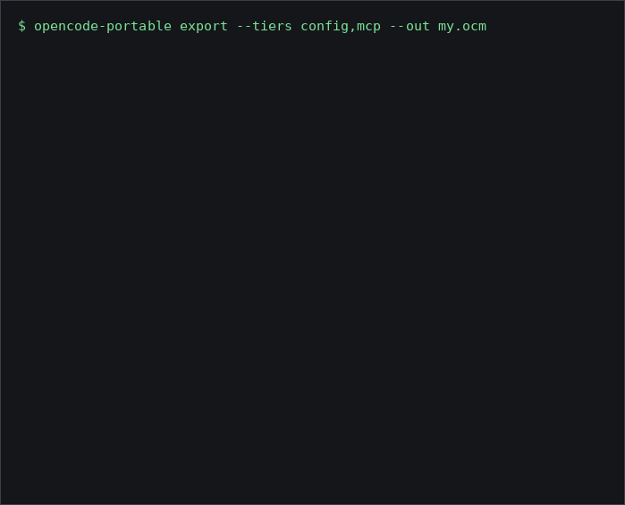

# opencode-portable

把 OpenCode 的配置、MCP 服务器、会话和凭据搬到另一台机器。覆盖 `config`、`mcp`、`state`、`sessions`、`credentials` 五个层级。

非官方项目，与 OpenCode 项目无任何关联，也未获得其背书。

## 为什么做这个

OpenCode 目前没有官方支持的方式把状态迁移到另一台机器（上游需求：anomalyco/opencode#54534）。本工具只通过 OpenCode 自己的命令和普通文件来完成这件事，不读它的数据库。

## 安装

需要 Node 20 或更新版本，以及 OpenCode v2.x。会话和凭据层级会调用 `opencode api`、`opencode session export/import` 和 `opencode auth export/import`，这些命令只在 v2.x 中存在——OpenCode v1（以及 `opencode-ai` 1.x 包）不受支持。

```
npm install -g @chncaesar/opencode-portable
# 或从源码安装
npm install && npm run build && npm link
```

## 用法

在旧机器上：

```
opencode-portable export --tiers config,mcp,state --out my.ocm
opencode-portable inspect my.ocm
```

在新机器上（先试运行，此时不写任何东西）：

```
opencode-portable import my.ocm
opencode-portable import my.ocm --apply
```

常用选项：

- `--tiers config,mcp,state,sessions,credentials` 选择要处理的内容（导出默认 `config,mcp`；导入默认处理归档里的全部）。
- `--out FILE` 导出时的归档路径。
- `--map SRC=DST` 路径映射规则，可重复。按最长完整目录前缀匹配，所以 `/home/me` 不会误匹配 `/home/me2`。源主目录到目标主目录的规则会自动加上。
- `--import-mcp-disabled` 以 `enabled: false` 添加新 MCP 服务器。
- `--overwrite-mcp NAME` 覆盖某个已存在的 MCP 服务器（可重复）。不指定时从不改动已存在的服务器。
- `--overwrite-config` 直接覆盖有差异的文件。默认写成 `NAME.incoming`。
- `--fail-on-secrets`（导出时）当插件脚本里含无法脱敏的内联密钥时，以错误退出。
- `--config-dir`、`--state-dir`、`--home` 覆盖位置。支持 `XDG_CONFIG_HOME` 和 `XDG_STATE_HOME`。



## 会话

会话迁移是可选功能：`--tiers config,mcp,state,sessions`。工具不读 OpenCode 的数据库。它通过运行中的 OpenCode 服务列出会话（`opencode api GET /api/session`，跟随分页），用 `opencode session export` 逐个导出，再在新机器上用 `opencode session import --directory DIR` 逐个导入。两台机器上都要有 `opencode` 在 PATH 里（或用 `OPENCODE_BIN` 指定），并且后台服务在运行。它必须是 v2.x 的二进制——用 `opencode --version` 确认；如果装了多个版本，请用 `OPENCODE_BIN` 显式指定 v2.x。

导出过滤：

- `--since 30d`（或 `90d`，或 `2026-01-01` 这样的日期）：只导出此后更新过的会话。
- `--project PATH_OR_ID`（可重复）：按目录或项目 ID 指定某个项目。
- `--max-sessions N`：最新的 N 个会话。被选会话的子代理会话总是包含在内。
- `--sanitize-sessions`：给 `opencode session export` 传 `--sanitize`。

会话内容可能包含密钥（聊天里粘贴过的 key、文件内容、命令输出），请把归档当作私密文件保管。

导入时试运行会按项目打印：归档路径、映射到的本地目录、匹配方式，以及每个会话会怎么处理（add / skip / conflict / detached）。每个项目的匹配顺序：

1. 显式的 `--map SRC=DST` 规则（若结果存在）。
2. 之前导入同一归档时保存的映射文件。
3. 有相同根提交的本地 git 克隆，扫描 `--scan-root DIR`（可重复；默认是主目录、`/work`、`~/code`、`~/Projects`、`~/src` 里存在的，深度四层）。
4. 主目录替换（若目录存在）。
5. 原路径（若在本机存在）。

没有匹配的项目会被标记为 detached，其会话被跳过。用 `--map` 规则、把仓库克隆到扫描根下、或 `--import-detached-to DIR` 来修复。

本地已有且更新时间的相同或更新的会话会被跳过（OpenCode 在导入时会重置更新时间，所以导入过的副本总是显得更新）。如果归档副本比本地新，会话会被标记为冲突并保持原样，因为不支持更新已有会话。`--apply` 时逐个导入（`--session-timeout SEC`，默认 120），单个失败不中断其余，最后打印汇总。失败详情写到状态目录下的 `opencode-portable.log`。

`--apply` 时确认过的映射会写到 `<archive>.mapping.json`，下次导入复用。显式 `--map` 仍优先于该文件。消息文本从不被改写，只选择目标目录。

## 内联配置密钥

导出 config 层时，结构化 JSON/JSONC 文件——`opencode.jsonc`（`mcp` 块之外，该块单独处理）、`tui.json` 和 `plugins/*.json`——会被扫描可能的密钥：key、token、secret、password 等键名下的值，以及常见 token 格式（`sk-`、`ghp_`、`github_pat_`、`xoxb-`、`AKIA...`、长 Bearer token）。已经是 `{env:NAME}` 或 `{file:...}` 形式的值不会动。

默认情况下，每个发现的密钥在归档副本里都被替换成 `{env:NAME}` 标记，名字由 JSON 路径生成（例如 `provider.anthropic.options.apiKey` 变成 `{env:PROVIDER_ANTHROPIC_OPTIONS_APIKEY}`）。注释和格式保持不变，你机器上的源文件永远不会被改。导出时会打印替换清单（文件、路径、标记——绝不打印值），`inspect` 也会显示。

插件脚本（`plugins/*.js`、`.mjs`、`.ts`）无法安全脱敏，所以只作为警告报告并原样复制。`--fail-on-secrets` 会让导出在这些无法脱敏的文件上中止。

## 凭据与安全模型

凭据是可选功能：把 `credentials` 加进 `--tiers`。它永远不在默认层级里。

- 加密的内容：`opencode auth export` 的输出（provider API key 和其他已存凭据）；加上 `--keep-secrets` 时，被 `{env:NAME}` 标记替换掉的 MCP 密钥和配置密钥的真实值。这些都放在归档里的一个文件 `secrets.enc` 中，用 AES-256-GCM 加密。密钥由你的口令经 scrypt（N=2^17、r=8、p=1、随机盐）导出。参数存在文件头里并被认证，以后可以上调。不加 `--keep-secrets` 时，这些被脱敏的值会被直接丢弃。
- 默认情况下，归档里根本没有这些配置密钥——它们在写盘之前就被替换成标记了。
- 不加密的内容：归档里的其他所有东西。配置文件、MCP 块（密钥已替换成标记）、用户状态和会话文本都是普通文件。会话文本可能含密钥（聊天里粘贴过的 key、文件内容、命令输出），所以任何归档都要私密保管。凭据的标签只有在解密后才可见。
- 永不导出：不读 `service.json` 和 `auth.json`。凭据只来自 `opencode auth export`。
- 远程 MCP 的 OAuth 令牌不迁移，因为其存储位置未经验证。在新机器上对每个远程服务器运行 `opencode mcp auth <name>`。

口令：故意没有 `--passphrase` 选项，因为命令行参数对其他用户可见、还会留在 shell 历史里。工具按以下顺序读取：`--passphrase-file PATH`（文件对他人可读时会警告；用 `chmod 600`）、环境变量 `OPENCODE_PORTABLE_PASSPHRASE`、终端里的隐藏输入（导出时要求输入两遍）。导出时口令至少 12 个字符。如果没有来源且没有终端，命令会报错停下。口令错误和文件损坏给的是同一条提示。

导出示例：

```
opencode-portable export --tiers config,mcp,credentials --keep-secrets --passphrase-file ~/.ocm-pass --out my.ocm
```

导入：试运行会提示归档里含有加密包。若口令通过文件或环境变量可用，还会列出凭据标签和 MCP/配置密钥的名字（绝不列值）。`--apply` 时凭据经一个临时文件（权限 0600，用后即删）交给 `opencode auth import`。机器上已存在的凭据不会被改动。

`--restore-secrets`（配合 `--apply`）把 MCP 和配置密钥的真实值写回本次运行写出的文件——包括 `NAME.incoming` 文件——并打印哪些文件现在含有明文密钥。POSIX 下这些文件以 0600 权限写入。`--restore-mcp-secrets` 是仅恢复 MCP 服务器的已弃用别名。两者都不加时，`{env:NAME}` 标记保留，计划里列出仍待填写的值。

不带 `--tiers` 且没有口令可用时，凭据会被跳过并给出提示。显式传 `--tiers credentials` 会把它变成错误。

## MCP 布局

两种 OpenCode MCP 布局都支持：旧的 `mcp.<name>` 条目（用 `enabled`）和 v2 的 `mcp.servers.<name>` 条目（用 `disabled`）。导入时按目标文件已有的布局写，需要时转换 `enabled`/`disabled`。目标没有 MCP 服务器时，用归档里的布局。

## 导出了什么

- config：去掉 `mcp` 块的 `opencode.jsonc`、`tui.json`、`AGENTS.md`、`package.json`，以及 `command`、`skills`、`agent`、`plugins` 目录（跟随符号链接）。不含：`node_modules`、`service.json`、`*.bak`。
- mcp：`mcp` 块。密钥值（环境变量、headers、URL 和参数里的密码）被替换成 `{env:NAME}` 标记（OpenCode 启动时从环境变量展开；已在 v2.2.5 验证）。导入计划列出仍需填写的值。
- state：`kv.json`、`model.json`、`prompt-history.jsonl`。
- sessions：`sessions/<id>.json`（`opencode session export` 原始输出）和 `sessions/index.json`。

## 安全性

- 除非传 `--apply`，导入都是试运行。
- 每个将被改动的文件先复制为 `<file>.bak-<timestamp>`。
- 归档校验和（SHA-256）在读取任何东西之前先验证。
- 错误信息用平实的中文。技术细节写到状态目录下的 `opencode-portable.log`。

## 平台

开发环境在 Linux 上测试；CI 用 Node 20 和 22 在 Linux、macOS、Windows 上跑测试。Windows 下支持 `opencode.cmd` 启动器，文件权限检查（`chmod 600`）不适用，配置里的符号链接目录按普通文件归档。

## 开发

```
npm test
npx tsc --noEmit
```
